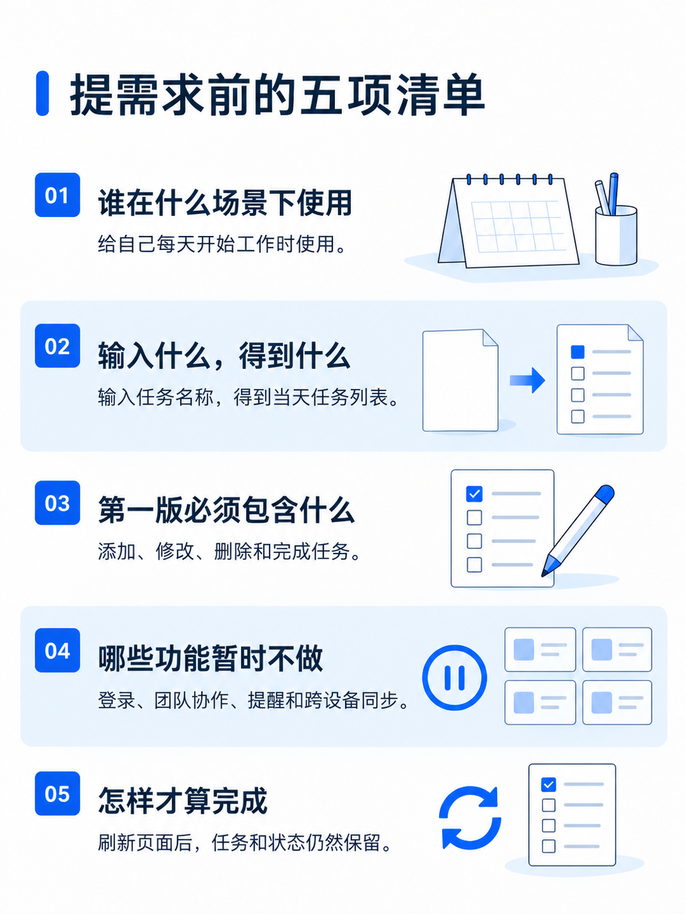
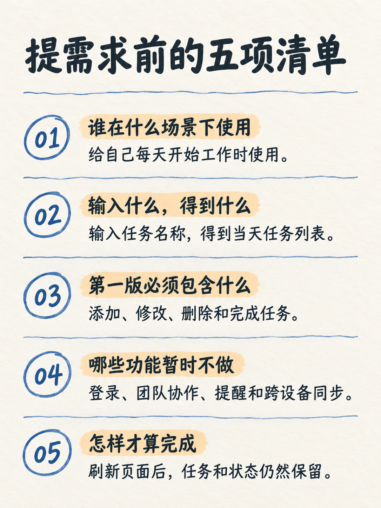
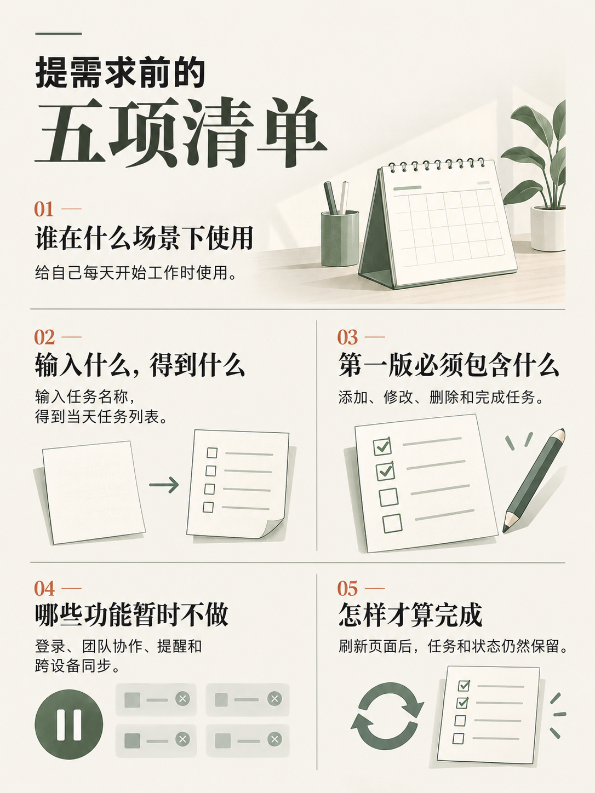
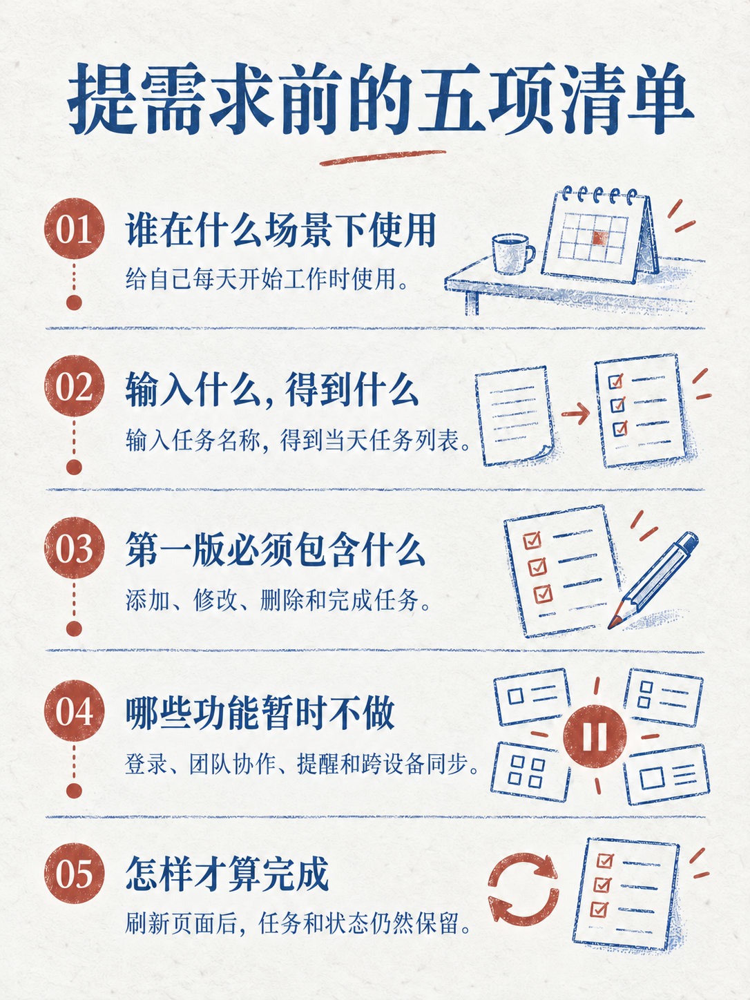
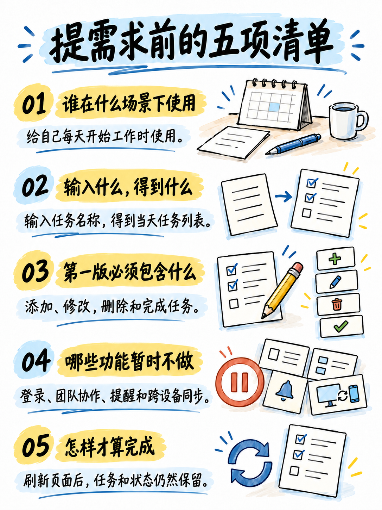
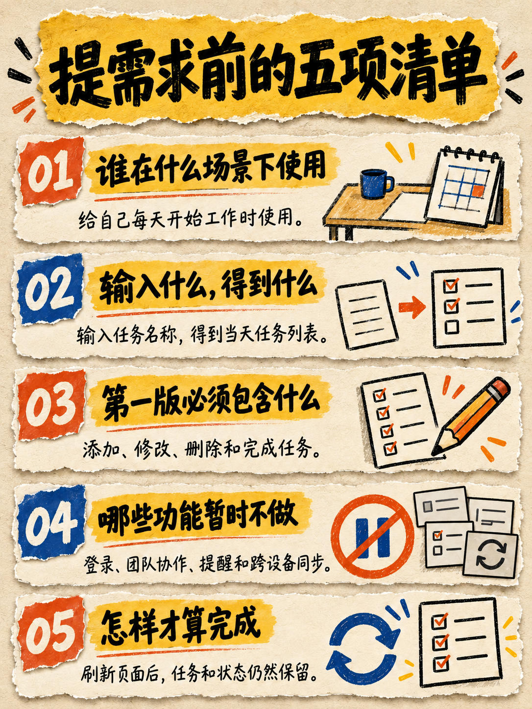
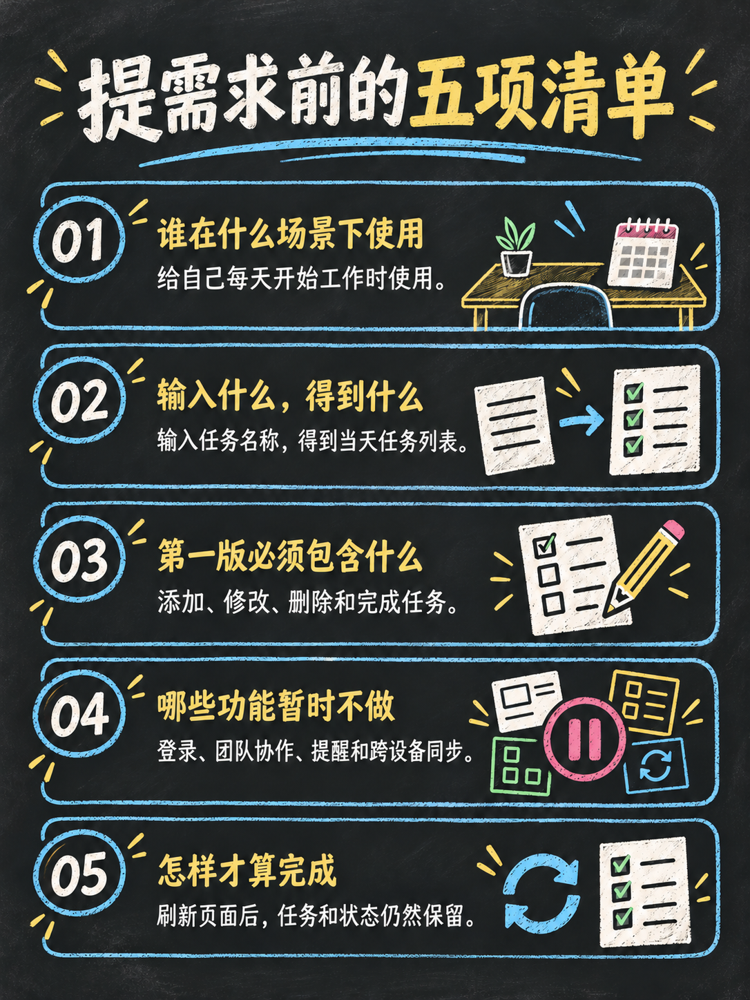

# atutun-xhs-cover

面向**小红书图文与抖音图文**的封面与正文图策划 Skill。封面包含 **12 种视觉风格**；正文独立提供 **8 种视觉主题 × 6 种内容布局**，默认采用 **`body-sketch` 手绘讲义**、无人物，也支持用户选择其他正文风格。同一份内容按平台分别策划，再输出逐图完整提示词；整组完成后默认补齐发布标题、备选、简短发布正文与标签，按阅读顺序交付。展示检查仅用于生图后的验收。

保留名称 `atutun-xhs-cover` 和原安装方式。原八款图片与提示词仍可复用，新流程不再要求固定八轮问答，也不要求真人出镜。**Hresh两平台01–12封面均必须出现已确认的虚拟人物，仅用户明确要求无人物或替换角色时例外。** 产品、截图或场景做主视觉时仍保留清楚可辨的人物；其他用户可自行选择主体。

封面、正文和配套发布文案不展示网址、域名、二维码或联系方式，不刻意引导访问、私信、评论领资料或关注互动；截图与参考素材也需检查。来源链接保留在内部工作记录，公开署源可用名称、文献标题或年份；正常的产品名称和教程步骤可保留。规则覆盖生图提示词、成品目视及文案复核，详见 [公开内容边界](atutun-xhs-cover/SKILL.md#公开内容边界不展示网址不刻意引导)。这是创作约束，不是平台审核结果保证，现有脚本不做OCR或引流识别。

01–08延续人物贴纸、大标题和场景纵深的视觉体系，支持真人或固定虚拟人物；Hresh 默认使用下方已确认的黑色T恤、蓝黄标题标准，其他用户可使用原浅黄/白色基础配色或自己的品牌。09–12补充知识专栏、专业科技、生活记录和数据报告风，允许产品或场景成为主体。适合 AI 工具、教程、测评、知识和经验分享。

## 当前支持与生成策略

| 平台 | 制作预设 | 生图前的区别 |
| --- | --- | --- |
| 小红书图文 | 3:4 · 1080×1440 | 突出主题与实用价值，可保留少量步骤、清单或证据 |
| 抖音图文 | 3:4 · 1080×1440 | 一个简短问题/卖点，放大一个视觉主体，减少辅助信息 |

**同为3:4也要分别设计与生成。** 例如同一资料整理主题，小红书可以呈现“流程＋三个步骤”，抖音可以呈现“资料太乱的问题＋清单结果”，不能裁切小红书成品充当抖音版。

上表是封面策略；正文另按每页问题、信息量和阅读顺序设计，不直接套用封面的短标题或辅助标签预算。这些是可调整的设计策略，非平台唯一审美、上传规格或算法规律。当前不处理抖音视频、公众号、视频号及朋友圈，后续范围见 [ROADMAP.md](ROADMAP.md)。详细规则见 [两平台生成策略](atutun-xhs-cover/references/platform-adaptation.md)。

## 正文模板与制作范围

支持**只做封面、只做正文、封面加正文**。旧调用未说明范围时继续只做封面，不自动扩张为整组。

封面与正文独立选择模板、配色和材质。正文默认不出现人物、头像、吉祥物或人物贴纸，包括总结页；不继承 Hresh 封面的人物母版、蓝黄大字或摄影背景。一组正文统一主题，不同页按内容选布局。

**未指定正文风格时，直接采用 `body-sketch` 手绘讲义。** 用户可以用下表中的主题 ID 或中文名称指定其他风格，例如“正文使用 `body-clean`”或“正文改成黑板粉笔风”；用户的明确选择优先，不再套用默认主题。此默认仅用于正文，封面仍单独选型。

| 正文主题 ID | 主题 | 适合内容 |
| --- | --- | --- |
| `body-clean` | 清爽文档：白底、小页签、克制标题、物件线图解与浅冰蓝分区 | 操作教程、工具说明、截图批注 |
| `body-sketch` | **手绘讲义（默认）**：米白底、工整正文、手绘线条与箭头 | 原理、流程、方法论；无人物 |
| `body-editorial` | 杂志图解：宋黑搭配、暖纸苔绿、不等宽编辑网格与物件主图 | 观点、案例、产品介绍 |
| `body-duotone-print` | 清透双色文艺印刷：轻纸面、蓝红双色、疏朗字形与细线物件 | 方法论、时间线、关系解释 |
| `body-crayon` | 颗粒蜡笔插画：温暖纸面、颗粒物件插画、清晰手写字 | 科普、分类与过程说明 |
| `body-digital-notes` | 清爽数字手绘注解：白底黑字、蓝黄批注、物件比喻 | 工作流、操作注解、问题拆解 |
| `body-paper-collage` | 撕纸手绘拼贴：撕边纸片、粗笔小标题、分组与克制叠层 | 避坑、模块拆解、方案比较 |
| `body-chalkboard` | 黑板粉笔：深色板面、浅色板书、彩色粉笔关系线 | 原理、系统结构、关系与流程 |

六种布局为：**观点解释 `explanation`、步骤流程 `steps`、截图批注 `screenshot`、双栏对比 `comparison`、清单卡片 `checklist`、关系图解 `relationship`**。主题决定视觉，布局决定信息组织；各主题的配色、结构、提示词片段与布局规则见 [正文模板](atutun-xhs-cover/references/body-templates.md)。

新增五套的参考图、字体、笔触、材质、解释图形与竖版重排规范见 [扩展正文风格](atutun-xhs-cover/references/body-styles-extended.md)。参考图随 Skill 安装，仅借鉴视觉特征，不复制其中的人物、头像、原文和数据；横图须按内容重新拆页与设计，不能直接裁成3:4。

正文流程为：**原文与证据 → 逐页文案 → 独立主题与逐页布局 → 代表性正文样张 → 后续页面 → 逐字与连续阅读检查**。真实截图缺失时不伪造界面；主题参考使用正文样张，不默认使用封面。详见 [正文制作流程与提示词示例](atutun-xhs-cover/references/body-images.md)。

八种正文主题的最终样图已统一保存到 [examples/body-styles-set-01](examples/body-styles-set-01/README.md)，使用同一份《提需求前的五项清单》文案，均为1086×1448、3:4、无人物，已在生成轮次逐张目视核对。Hresh 此前表达了对手绘讲义的偏好，并对新增五款给予正面反馈；手绘标题大小按内容判断，不机械缩小。

示例目录包含8款当前样图、生成与修正提示词、实际参考素材、版本历史和[生成清单](examples/body-styles-set-01/manifest.json)，不依赖原生成目录即可查看。新增五款展示局部移除头像符号后的版本，原 `output/` 记录保留。清爽文档与杂志图解已按用户反馈重新设计，总览展示[当前版本与新旧对照](examples/body-styles-set-01/revisions/02-clean-editorial/index.html)，旧图保留；用户已确认采用清爽文档v3与杂志图解v2，作为两套主题的当前版本；清爽版保留较强功能性。蜡笔版边缘留白略紧、拼贴版视觉较浓，详见[复核说明](examples/body-styles-set-01/review.md)。其他布局、完整系列及平台上传展示仍待验证，8×6组合不代表48张已完成或已验证的图片。

## 正文视觉风格效果（8款）

[打开八款总览](examples/body-styles-set-01/index.html) · [示例说明与提示词入口](examples/body-styles-set-01/README.md) · [测试文案](examples/body-styles-set-01/source.md)

点击图片查看原图。以下均为小红书正文的单页清单视觉示例；字体、材质与图形表达可独立选择，封面不必采用相同主题。

<table>
  <tr>
    <td width="50%" valign="top">
      <h3>01 · 清爽文档 · v3</h3>
      <a href="examples/body-styles-set-01/revisions/02-clean-editorial/body-clean-v3.png"></a>
      <p>单行克制标题、蓝色小页签、物件线图解和浅冰蓝分区，已目视核对并获用户确认采用。</p>
    </td>
    <td width="50%" valign="top">
      <h3>02 · 手绘讲义</h3>
      <a href="examples/body-styles-set-01/body-sketch.png"></a>
      <p>默认正文主题：米白纸纹、清晰手写字、蓝色圈线与浅橙笔刷；可按需求选择其他主题。</p>
    </td>
  </tr>
  <tr>
    <td width="50%" valign="top">
      <h3>03 · 杂志图解 · v2</h3>
      <a href="examples/body-styles-set-01/revisions/02-clean-editorial/body-editorial-v2.png"></a>
      <p>宋黑搭配、暖纸苔绿、不等宽编辑网格与物件主图，已目视核对并获用户确认采用。</p>
    </td>
    <td width="50%" valign="top">
      <h3>04 · 清透双色文艺印刷</h3>
      <a href="examples/body-styles-set-01/body-duotone-print.png"></a>
      <p>蓝红双色、中文衬线字与细线物件，保留轻印刷质感和留白。</p>
    </td>
  </tr>
  <tr>
    <td width="50%" valign="top">
      <h3>05 · 颗粒蜡笔插画</h3>
      <a href="examples/body-styles-set-01/body-crayon.png"></a>
      <p>暖纸面、蜡笔颗粒和彩色物件插画，适合分类、过程与科普说明。</p>
    </td>
    <td width="50%" valign="top">
      <h3>06 · 清爽数字手绘注解</h3>
      <a href="examples/body-styles-set-01/body-digital-notes.png"></a>
      <p>白底手写字、蓝黄批注与物件图解，适合工作流和问题拆解。</p>
    </td>
  </tr>
  <tr>
    <td width="50%" valign="top">
      <h3>07 · 撕纸手绘拼贴</h3>
      <a href="examples/body-styles-set-01/body-paper-collage.png"></a>
      <p>撕边纸片、粗笔标题和轻微叠层，用独立纸片组织信息分组。</p>
    </td>
    <td width="50%" valign="top">
      <h3>08 · 黑板粉笔</h3>
      <a href="examples/body-styles-set-01/body-chalkboard.png"></a>
      <p>深色板面、浅色板书和粉笔物件，适合原理、结构与关系说明。</p>
    </td>
  </tr>
</table>

## 封面模板效果

### 当前已确认标准

[](atutun-xhs-cover/assets/hresh-cover-approved.png)

Hresh 默认以这张1086×1448（3:4）小红书封面作为视觉参考：**黑色圆领T恤手绘人物、亮蓝第一行与明黄重点行、低饱和摄影背景、黑白辅助信息、无账号署名**。人物身份和视觉效果分别由两张随包素材控制，详细规则见[当前封面标准](atutun-xhs-cover/references/virtual-character.md#当前封面标准)。新选题按平台与模板独立设计，不照抄示例标题、场景或动作；09–12保留各自简洁或证据优先的结构。

**标题字形与字效同样是强制标准**：参考图中的粗壮紧凑字形、深色厚字效、细白边与硬阴影都须对照，不是只保留蓝黄配色。生图或后期排字均须实际参考该图；交付前逐字并排复核字形、字重、间距、描边、阴影和缩略图可读性，未通过不得标为最终成品。仅用户明确要求其他标题风格或无字时例外。详细要求见[标题字形与字效强制验收](atutun-xhs-cover/references/virtual-character.md#标题字形与字效强制验收)。

仅此张新版已获得用户视觉确认，其他模板和抖音新版尚未按此标准重新生成与检查。完整生成记录保留于[蓝黄字体版提示词](output/01-black-tee-cover-v2-blue-yellow-prompt.md)。

### 历史风格示例

[第一套12款虚拟人物示例](examples/virtual-character-set-01/index.html)使用旧蓝黄服装，保留用于构图对照，不作为当前衣着、标题色或背景材质的默认标准。12张均为1086×1448（3:4），仅为小红书图文示例；[独立目录与说明](examples/virtual-character-set-01/README.md)包含原图、完整提示词、参考素材及复核记录，原八款图片保留。

以下是已生成的01–08风格示例，单张尺寸均为 **1086 × 1448（3:4）**；它们用于展示视觉风格，尚不是按同一主题分别生成的两平台对照成品。点击图片查看原图，也可以查看 [八款总览](examples/overview.png)。

<table>
  <tr>
    <td width="50%" valign="top">
      <h3>01 · 爆款大字压顶风</h3>
      <a href="examples/01-ai-tools.png"></a>
      <p>两行大字与人物紧密衔接，真实场景和前景遮挡增加层次。适合强钩子标题、经验分享和教程入口。</p>
    </td>
    <td width="50%" valign="top">
      <h3>02 · 巨字拆分冲击风</h3>
      <a href="examples/02-giant-word-impact.png"></a>
      <p>核心词块围绕人物排布，字形、手势和箭头形成动势。适合概念、能力和身份类主题。</p>
    </td>
  </tr>
  <tr>
    <td width="50%" valign="top">
      <h3>03 · 小白科普问答风</h3>
      <a href="examples/03-beginner-qa.png"></a>
      <p>口语化问题、疑惑表情和问号搭配学习标签。适合解释概念、回答常见问题和零基础科普。</p>
    </td>
    <td width="50%" valign="top">
      <h3>04 · 教程清单风</h3>
      <a href="examples/04-tutorial-checklist.png"></a>
      <p>人物指向侧边步骤，绿色勾选与底部短句突出上手路径。适合安装、部署和全流程教程。</p>
    </td>
  </tr>
  <tr>
    <td width="50%" valign="top">
      <h3>05 · 产品测评榜单风</h3>
      <a href="examples/05-product-comparison.png"></a>
      <p>巨大数字、产品卡片和指向箭头突出比较主题。适合工具横评、产品榜单和选择建议。</p>
    </td>
    <td width="50%" valign="top">
      <h3>06 · 种草推荐风</h3>
      <a href="examples/06-warm-recommendation.png"></a>
      <p>暖色生活场景、微笑点赞和推荐贴纸营造亲切感。适合工具、播客、书籍与资源推荐。</p>
    </td>
  </tr>
  <tr>
    <td width="50%" valign="top">
      <h3>07 · 贴纸拼贴入门风</h3>
      <a href="examples/07-sticker-beginner.png"></a>
      <p>上下标题包围人物，工具卡片错落分布。适合入门指南、工具组合和工作流搭建。</p>
    </td>
    <td width="50%" valign="top">
      <h3>08 · 黑底效率工作流风</h3>
      <a href="examples/08-dark-workflow.png"></a>
      <p>深色工作场景、工具墙和绿色清单突出效率收益。适合个人工作法、自动化和工具组合分享。</p>
    </td>
  </tr>
</table>

示例使用 AI 图片生成模型制作，用于展示构图与视觉效果；“5款实测”“效率翻倍”等示例文案不代表实际测评或效果承诺。生成结果会受模型、人物参考图和最终提示词影响。

## 新增四种视觉风格

| 编号 | 风格 | 适合内容 | 视觉重点 |
| --- | --- | --- | --- |
| 09 | 极简知识专栏风 | 系统解释、知识系列、方法论 | 一个概念、稳定对齐、留白与品牌识别 |
| 10 | 专业科技测评风 | 软件、AI工具与数码 | 真实产品/界面证据、理性比较 |
| 11 | 真实生活记录风 | 经历、工作过程与生活 | 自然摄影、真实环境、少量文字 |
| 12 | 数据分析报告风 | 有来源的数据与行业观察 | 单一重点图形、正确单位和事实边界 |

四种风格的规则与提示词骨架已提供，对应图片已纳入[虚拟人物示例集](examples/virtual-character-set-01/index.html)。10为工具概念、11为生成场景、12为无数据的定性流程，不代表真实测评或用户环境照片。参见 [扩展视觉库](atutun-xhs-cover/references/styles-extended.md)。

## 快速开始

将仓库中的 `atutun-xhs-cover` 目录复制到 Codex 的 skills 目录：

```bash
cp -R atutun-xhs-cover ~/.codex/skills/
```

安装后调用：

```text
$atutun-xhs-cover
```

也可以直接说明需求：

```text
$atutun-xhs-cover
这是我的文章：[粘贴正文]
用于小红书图文和抖音图文，均为3:4。
按平台分别确定标题、辅助信息和构图，再给两份完整生图提示词。
可以复用同一风格与配色，但不要裁切同一成品代替两个版本。
```

只做正文时，不指定风格即使用默认的 `body-sketch` 手绘讲义：

```text
$atutun-xhs-cover
这是测试文档：[粘贴正文或提供文件路径]
只制作小红书正文图片，不做封面，正文不要人物。
按内容拆页并选择合适布局，直接生成。
```

选择其他正文风格时，在请求中明确主题 ID 或中文名称即可，例如改用清爽文档：

```text
$atutun-xhs-cover
这是我的文章：[粘贴正文或提供文件路径]
只制作小红书正文图片，不做封面。
正文使用 body-clean 清爽文档主题，按内容拆页，直接生成。
```

整组制作时，可分别指定“封面使用内置虚拟人物与01风格；正文使用杂志图解主题，无人物”。比较主题时可指定“用同一页、同一文案和布局，分别制作三种正文主题样张”，不必先生成三套完整正文。

也可以直接指定新增风格，例如“正文使用清爽数字手绘注解 `body-digital-notes`，按内容组织截图批注或流程，默认无人物”；“正文使用黑板粉笔 `body-chalkboard`，用关系图解释原理”。只写引入风格时更新模板，不自动生成图片；明确要求生成时再制作所选版本。

## 使用流程

先确定制作范围，再提取五类信息：**内容、平台版位、主体、素材、偏好**。从当前消息提取已知信息；正文未指定风格时采用 `body-sketch`，指定时使用用户选择的主题，封面未指定风格时由 Skill 推荐。仅缺少会改变结果的信息时补问。未指定平台时会说明默认小红书图文，正文不询问人物照片。

封面流程是：**内容分析 → 两平台分别制定生成策略 → 组合风格 → 各自完整提示词 → 分别生图 → 事后展示检查**。封面可复用人物身份与品牌配色；正文另走上述拆页与样张流程。用户锁定文案时保留原文，不为增加点击虚构数字或效果。

### 整组完成后，补齐发布文案

封面＋正文图片完成并复核后，默认按已选平台补充 **1个推荐发布标题＋2个不同切口的备选＋一段简短发布正文＋相关标签**，写入最终交付，不等用户再追问。发布标题与封面大字独立：封面交代对象，发布标题可补具体痛点、用法或判断，承诺必须能由内容兑现。小红书标题采用不超过20字符的编辑预算，并记录实际字符数；这是本 Skill 的编辑预设，不声称是已核验的上传限制。用户锁定的标题保持原文，超预算时提醒；用户只补标签时不改已有标题。

简短发布正文默认约60–120字，概括图文解决的问题、关键做法或结论，可直接粘贴到发帖正文框。

标签围绕主题、任务、场景和目标读者选择，小红书默认6–8个，可按内容增减；不把未查询的建议词称为热词，不用无关标签凑数量。需要时可按 [发布文案流程](atutun-xhs-cover/references/publication-copy.md) 检索同类 GitHub 项目，参考真实定位与方法，不强制每次联网或登录小红书，也不承诺“必爆”。

已有图片后，可直接说：

```text
$atutun-xhs-cover
沿用刚才这组图片，只补一段小红书发布正文，概括问题和关键做法。
```

用户明确只要图片时跳过发布文案。只做封面、只做正文、提示词或风格候选时不默认追加发布文案；不执行实际发布。

这个 Skill 提供策划、提示词、发布文案与本地交付脚本，不包含独立生图或发布服务。用户要求图片时，由当前环境可用的图片工具制作所选版本；只要求提示词时不会自动生图。

### Hresh封面必须保留固定虚拟人物

为 Hresh赫什制作封面时，必须出现已确认虚拟人物；生图实际传入随 Skill 保存的[黑色T恤人物母版](atutun-xhs-cover/assets/hresh-character-black-tee.png)与[已确认效果参考](atutun-xhs-cover/assets/hresh-cover-approved.png)，无需提供真人照片。保持深色短发、浅胡茬、蜡笔质感与白色贴纸边，当前服装为纯黑色圆领短袖；按选题变化表情、动作和构图，用户指定时可独立换装。仅用户明确要求无人物或替换角色时例外，并记录其原始指令；“不用真人照片”“封面无字”“产品为主”不取消人物要求。原蓝黄母版及第一套12款示例保留，未自动重做；其他用户使用自己的主体与母版。

```text
$atutun-xhs-cover
用内置的 Hresh 虚拟人物，不用真人照片。
内容：[粘贴正文]
用于小红书图文和抖音图文，按各自策略给出完整提示词。
保持人物身份和手绘画风，穿纯黑色圆领T恤，分别安排动作、辅助信息和构图。
按已确认效果参考使用亮蓝/明黄标题与低饱和背景，不加账号署名。
```

01–08可将人物作为主视觉；09–12可将概念、产品、场景或数据作为主视觉，Hresh人物作为清楚可辨的辅助讲解者保留，不因风格或平台自行省略。产品截图和数据仍须有真实依据。完整要求见[Skill入口的人物要求](atutun-xhs-cover/SKILL.md#hresh-封面人物要求)与[固定虚拟人物规则](atutun-xhs-cover/references/virtual-character.md)。旧12款已生成并逐张目视检查，新版01视觉方向已获用户确认；新版其他模板与虚拟人物抖音版尚未生成，平台上传展示尚未检查。

## 生图后的检查（可选）

主要检查3:4原图、文字准确性、主体层级、基础边距与缩略图可读性，不生成平台方案或把图片转换成另一平台版本。

<details>
<summary>查看检查脚本与演示</summary>

```bash
python3 atutun-xhs-cover/scripts/preview_covers.py \
  --manifest examples/platform-preview.json \
  --out-dir .tmp/platform-preview-new
```

[检查演示](examples/platform-preview/index.html) · [结构化报告](examples/platform-preview/report.json) · [输入说明](atutun-xhs-cover/references/preview-workflow.md)

演示使用历史PNG，仅说明检查流程。输入区域由人工标注，不做OCR；报告仍需目视复核。目录已存在时换新目录，不覆盖旧结果。此前五版位裁切演示已归档，不作为当前能力。

</details>

## 最终图片顺序与打包

实际成品交付使用独立的 [交付清单与脚本](atutun-xhs-cover/references/final-delivery.md)。每个平台单独选择最终版，明确阅读顺序及计划正文数量；脚本拒绝重复封面、封面不在首张、页序重复或断号、正文缺页、重复图片及未标记为最终且已复核的文件。预览工具仍允许多候选比较，不用预览列表代替最终发布顺序。

新制或重制Hresh封面时，先目视确认已确认人物实际出现、身份一致且在原图与缩略图中可辨认，再标记 `reviewed` 和 `final`。实际参考、查看的成品与结论，以及用户明确例外的原始指令记入工作记录；未通过先修正，不得打包为成品。预览和打包脚本不识别人物，结构检查成功不能代替此验收。

新做整组时，在 `publication` 中填写推荐标题、简短发布正文（`body`）和标签。脚本要求整组提供标题和标签，校验传入的正文为非空字符串，并兼容没有 `body` 的历史文案清单。用户明确只要图片时在下方命令追加 `--images-only`，也可用该模式兼容旧版纯图片清单。

```bash
python3 atutun-xhs-cover/scripts/package_images.py \
  --manifest .tmp/<topic-slug>/delivery-input.json \
  --out-dir output/<topic-slug>
```

默认每个平台只输出 `images/` 中的统一编号原图、`index.html` 总览，以及有发布文案时的 `publication.md`。不再生成重复的README、JSON/Markdown顺序清单和压缩包；需要ZIP时追加 `--zip`。只做正文从 `01-body-01.png` 开始，整组从 `01-cover.png` 开始。最终回复按脚本校验后的页序标清“第N张·封面/正文NN”。脚本不控制生图工具自动展示的中间消息，也不执行视觉或上传验证。

页计划、来源路径、逐页完整提示词和复核记录集中在 `.tmp/<topic-slug>/work.md`，生成原图、历史修订与交付输入也在该工作目录；源文默认引用原文件，不复制。检查预览引用原图，不再复制一套 `assets/` 或另存缩小图。用户要求可复现资料时才整理必要的 `process/`，只做策划时将 `work.md` 作为交付物保存在输出目录。

首次输出目录须不存在。只补发布文案时，修改原交付输入后追加 `--update-publication`，脚本核对图片集合、内容和页序不变，只更新同一目录的文案和HTML，不再新建 `final-with-publication/`；不能与 `--zip` 同用。重新制图则先明确归档旧交付，保持一个当前入口，不静默覆盖。最终回复同时给可复制文案，不只交附件。

## 视觉与事实约定

- 当前两平台均采用3:4，风格不绑定平台；生成目标、标题与信息预算分别决定。
- 正文独立选主题，每页按内容选布局，默认无人物；封面的身份、配色与材质不自动传入正文。
- 01–08的通用模板使用浅黄/白色基础字效；Hresh 默认以已确认效果图的亮蓝/明黄替换原配色。09–12使用自己的视觉结构，人物与品牌偏好不强制改变其信息层级。
- 真人身份来自参考照，虚拟人物身份与画风来自已确认母版；不把虚拟人物写实化，不索要真人照来维持虚拟身份。Hresh封面仅在用户明确要求无人物或替换角色时例外；无人物方案可用产品、环境和概念图，装饰服务于主题。
- 封面默认不添加账号名称、署名、账号水印或个人品牌Logo；使用固定人物不意味着在图片上写账号名称，用户明确要求时才添加。
- “5款”“实测”“零基础”“效率翻倍”等表达须有材料依据；分析图表不编造数值或评分。
- 两平台分别记录页计划、完整提示词和原图，过程文件集中在工作目录，检查视图不冒充成品。中文标题、正文、图注逐字核对，含标点；流程与关系图核对箭头方向和条件。
- 可编辑文字需交付真实文字图层或独立文案与布局记录；当前脚本不合成文字、不导出最终位图。

具体规则见 [Skill 入口](atutun-xhs-cover/SKILL.md)、[原八款视觉库](atutun-xhs-cover/references/styles-atutun.md) 和 [第01款历史示例](atutun-xhs-cover/references/style-01-ai-tools.md)。

[完整两平台示例](atutun-xhs-cover/references/multi-platform-example.md)展示同一09知识专栏风在相同3:4比例下，为小红书与抖音图文分别输出生成目标、标题、信息量、构图和最终提示词。

## 目录说明

```text
.
├── README.md
├── AGENTS.md                    # 项目约定与验证入口
├── MVP.md / ARCHITECTURE.md / TECH-STACK.md
├── atutun-xhs-cover/             # 复制此目录安装 Skill
│   ├── SKILL.md                  # 五类输入与两平台生成工作流
│   ├── agents/openai.yaml
│   ├── assets/hresh-character-black-tee.png # 当前默认黑色T恤人物母版
│   ├── assets/hresh-cover-approved.png # 用户已确认的蓝黄字体效果参考
│   ├── assets/hresh-character.png # 原蓝黄母版，保留历史引用
│   ├── assets/body-style-references/ # 五张新增风格参考与偏好的手绘讲义样张
│   ├── references/               # 12种封面风格、正文8主题/6布局、平台预设与预览说明
│   └── scripts/                  # Python 标准库脚本
│       ├── preview_covers.py     # 多候选展示检查
│       └── package_images.py     # 唯一最终版、阅读顺序与原图打包
├── tests/                       # 预览几何与输入/输出保护
└── examples/                    # 封面历史示例、正文8款与可复用生成输入
    └── body-styles-set-01/      # 正文原图、总览、提示词、参考与复核记录
```

`examples/` 供浏览和对照，不需要复制到 skills 目录。历史八款示例的真人与风格参考原图未包含在仓库中；Hresh 当前人物母版与已确认效果参考均保存在 `atutun-xhs-cover/assets/`，随 Skill 一起安装，不依赖 `output/` 或临时附件。其他人物请提供自己的参考图。更多记录见 [示例说明](examples/README.md)。

## 本地验证

```bash
python3 -m unittest discover -s tests -v
git diff --check
```
